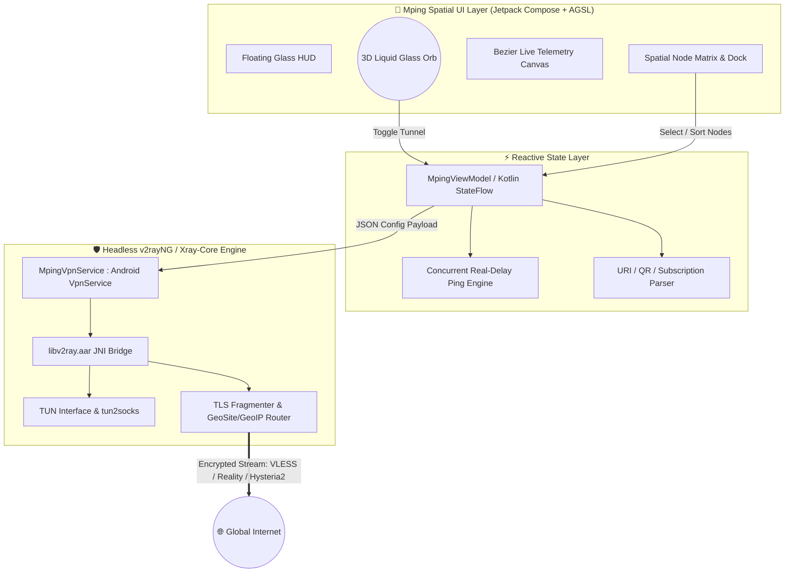

<div align="center">

<!-- Animated SVG Header / Typing Banner -->


<p align="center">
  <b>An Ultra-Modern, Zero-Inheritance Android Proxy & Tunnel Client Powered by Headless Xray-core (`libv2ray`) and Engineered with an Apple iOS 27 / visionOS Liquid Glass Spatial UI.</b>
</p>

<!-- Shields.io Dynamic Badges -->
<p align="center">
  <a href="https://github.com/mwortezza/Mping/stargazers"></a>
  <a href="https://github.com/mwortezza/Mping/network/members"></a>
  <a href="https://github.com/mwortezza/Mping/releases"></a>
  <a href="https://github.com/mwortezza/Mping/actions"></a>
</p>

<p align="center">
  
  
  
  
  
</p>

<br/>

<h4>
  <a href="#-english-documentation">🌐 English Documentation</a>
  <span> · </span>
  <a href="#-مستندات-فارسی-persian-documentation">🇮🇷 مستندات فارسی</a>
  <span> · </span>
  <a href="https://github.com/mwortezza/Mping/releases">📦 Download APK</a>
  <span> · </span>
  <a href="https://github.com/mwortezza/Mping/issues">🐞 Report Bug</a>
</h4>

</div>

---

## 🌐 English Documentation

### ✨ Overview

**Mping** (`com.mping.vpn`) is a next-generation Android VPN and proxy tunnel client that completely reimagines network security interfaces. While maintaining **100% backend parity** with the battle-tested [v2rayNG](https://github.com/2dust/v2rayNG) engine (`libv2ray.aar` / Xray-core), Mping discards all legacy XML/Material layouts in favor of a **from-scratch, 120Hz Spatial "iOS 27 Liquid Glass" User Interface** built with Jetpack Compose and real-time GPU shaders.

### 💎 Key Architectural Highlights

| Layer | Feature | Technical Implementation |
| :--- | :--- | :--- |
| **Spatial UI Engine** | **Real-Time Frosted Liquid Glass** | Multi-layered `RenderEffect.createBlurEffect`, translucent frosted matrices (`alpha = 0.14f`), and 1px specular refractive gradient borders. |
| **Interactive Core** | **3D Breathing Liquid Orb** | Custom Compose `Canvas` & AGSL Shader centerpiece with spring-physics (`DampingRatioLowBouncy`) and full-screen shockwave ripples upon connection. |
| **Ambient Shader** | **Bioluminescent Mesh Background** | Dynamic 60/120fps fluid background shifting between Deep Obsidian (`#05070B`), Liquid Cyan (`#00F5D4`), and Neon Rose (`#F72585`) based on tunnel telemetry. |
| **Tunnel Backend** | **Headless Xray-core & TUN** | Direct JNI bindings to `libv2ray.aar`, `VpnService` `ParcelFileDescriptor` management, and high-throughput `tun2socks` packet routing. |
| **Anti-DPI Arsenal** | **TLS Fragment & Multiplexing** | Built-in `ClientHello` packet fragmentation (`10-50 bytes` / `10-20ms` delay) to bypass deep packet inspection (DPI) firewalls seamlessly. |
| **Concurrency** | **Mping Real-Delay Engine** | Asynchronous coroutine-based HTTP `204` / TCP handshake latency verifier that benchmarks and auto-sorts nodes in milliseconds. |

---

### 🧠 System & Tunnel Architecture



---

### 🚀 Supported Protocols & Transports

* **Protocols:** `VLESS` (XTLS-rprx-vision), `VMess`, `Trojan`, `Shadowsocks (AEAD)`, `Hysteria2`, `WireGuard`, `Socks5`, `HTTP`.
* **Transport Layers:** `REALITY`, `TLS 1.3`, `gRPC`, `WebSocket (WS)`, `HTTPUpgrade`, `SplitHTTP`, `TCP`, `mKCP`, `QUIC`.
* **Routing & Split Tunneling:**
  * Bypass LAN & Mainland/Direct National IPs (`GeoIP:IR` / `GeoSite:IR`).
  * Granular **Per-App Proxy** with glassmorphic search and package filter.
  * Custom DNS-over-HTTPS (DoH) & FakeDNS integration.

---

### 🛠️ Build & Installation (`Mping.apk`)

#### Option 1: Direct Download (Recommended)
Download the latest signed `.apk` directly from the [**GitHub Releases**](https://github.com/mwortezza/Mping/releases) page or grab the latest build artifact from the [**GitHub Actions**](https://github.com/mwortezza/Mping/actions) tab.

#### Option 2: Build from Source Locally
```bash
# 1. Clone the repository
git clone [https://github.com/mwortezza/Mping.git](https://github.com/mwortezza/Mping.git)
cd Mping

# 2. Ensure libv2ray.aar is placed inside app/libs/
mkdir -p app/libs

# 3. Compile the Release APK via Gradle Wrapper
chmod +x gradlew
./gradlew assembleRelease
```

---
---

<div dir="rtl" align="right">

## 🇮🇷 مستندات فارسی (Persian Documentation)

### 🌟 معرفی پروژه **Mping**

اپلیکیشن **Mping** (`com.mping.vpn`) یک کلاینت نسل جدید، فوق‌سریع و امن برای اندروید است که **بدون هیچ‌گونه ارث‌بری ظاهری از قالب‌های قدیمی**، از صفر بر پایه زبان طراحی فضایی **Apple iOS 27 / visionOS Liquid Glass** مهندسی شده است.

این پروژه در لایه ظاهری (Frontend) یک رابط کاربری ۱۰۰٪ شیشه‌ای، شناور و سه بعدی را با نرخ نوسازی **۱۲۰ هرتز** ارائه می‌دهد و در لایه زیرساخت (Backend)، از موتور قدرتمند و اثبات‌شده‌ی **[v2rayNG](https://github.com/2dust/v2rayNG)** و هسته **Xray-core (`libv2ray.aar`)** بهره می‌برد.

---

### 🎨 ویژگی‌های منحصربه‌فرد رابط کاربری (iOS 27 Liquid Glass UI)

1. **معماری تمام شیشه‌ای با شکست نور زنده (Real-Time Refraction):**
   * تمامی کارت‌ها، پنل‌ها، نوار ناوبری کپسولی و پنجره‌ها دارای ماتریس بلور زنده (`RenderEffect`)، لایه نیمه‌شفاف یخی و حاشیه‌های ۱ پیکسلی براق (Specular Borders) هستند که بازتاب نور را شبیه‌سازی می‌کنند.
2. **گوی شیشه‌ای سه‌بعدی در مرکز داشبورد (Mping 3D Liquid Orb):**
   * جایگزین دکمه‌های سنتی اتصال؛ یک گوی انرژی مایع و زنده که با لمس کاربر، موج نوری (Shockwave) در کل صفحه ایجاد کرده و اتصال تانل را برقرار می‌کند.
3. **پس‌زمینه بیولومینسنس پویا (Dynamic Mesh Shader):**
   * حرکت نرم گوی‌های نوری در پس‌زمینه تیره (`#05070B`) که با تغییر وضعیت اتصال از حالت آماده به کار به حالت متصل (Connected)، رنگ و سرعت جریان آن‌ها به طیف فیروزه‌ای (`#00F5D4`) و آبی الکتریکی تغییر می‌یابد.
4. **نمودار ترافیک زنده با منحنی‌های بزیه (Live Telemetry Canvas):**
   * نمایش لحظه‌ای سرعت دانلود، آپلود، حجم مصرفی و پینگ واقعی روی یک ویجت شیشه‌ای منحنی با انیمیشن‌های روان.

---

### ⚙️ قابلیت‌های فنی و مهندسی بک‌اند (هسته کامل v2rayNG)

* 🛡️ **پشتیبانی کامل از پروتکل‌های روز:**
  * پشتیبانی بی‌نقص از `VLESS` (به همراه `REALITY` و `XTLS-rprx-vision`)، `VMess`، `Trojan`، `Shadowsocks`، `WireGuard` و پروتکل پرسرعت `Hysteria2`.
* ⚡ **موتور تست پینگ واقعی همزمان (Mping Real-Delay Tester):**
  * تست موازی (Concurrent) تمامی سرورها از طریق درخواست واقعی HTTP `204` و دست‌دهی TCP و مرتب‌سازی خودکار کانفیگ‌ها بر اساس کمترین تاخیر (`ms`).
* 🧩 **عبور از فیلترینگ هوشمند (TLS Fragmentation & Anti-DPI):**
  * مجهز به ماژول تکه‌تکه کردن پکت‌های `TLS ClientHello` (تنظیم سایز و تاخیر فرگمنت) جهت عبور از فایروال‌های مبتنی بر بررسی عمیق بسته‌ها (DPI) روی اپراتورهای مختلف.
* 🔄 **مدیریت هوشمند اشتراک‌ها و کانفیگ‌ها (Subscriptions & Clipboard):**
  * ایمپورت سریع از کلیپ‌بورد، اسکنر QR Code با کادر شیشه‌ای و بروزرسانی خودکار لینک‌های سابسکریپشن (Base64 / Raw / Clash).
* 📱 **تفکیک ترافیک برنامه‌ها و مسیریابی (Per-App Proxy & Geo-Routing):**
  * قابلیت انتخاب برنامه‌های خاص برای عبور یا عدم عبور از تانل وی‌پی‌ان + مسیریابی هوشمند برای مستقیم کردن ترافیک سایت‌ها و آی‌پی‌های داخلی (`Bypass LAN & Iran IPs`).

---

### 📥 راهنمای دانلود و نصب فایل APK

برای دریافت فایل نصبی آماده **`Mping.apk`** به یکی از دو روش زیر عمل کنید:

1. **دانلود مستقیم از بخش Releases:**
   * وارد بخش [**Releases**](https://github.com/mwortezza/Mping/releases) در سمت راست همین صفحه شوید و آخرین نسخه فایل `Mping-iOS27-LiquidGlass.apk` را دانلود و روی گوشی اندرویدی خود نصب کنید.
2. **دریافت از GitHub Actions (بیلد خودکار ابری):**
   * وارد تب [**Actions**](https://github.com/mwortezza/Mping/actions) در بالای ریپازیتوری شوید، روی آخرین گردش‌کار سبز رنگ کلیک کنید و از بخش **Artifacts** در پایین صفحه، فایل APK کامپایل‌شده را دانلود نمایید.

---

### 📂 ساختار دایرکتوری پروژه

</div>

```text
Mping/
├── .github/workflows/
│   └── android-apk.yml          # Automated Cloud CI/CD APK Builder & Signer
├── app/
│   ├── libs/
│   │   └── libv2ray.aar         # Headless Xray-core / Go JNI Binary
│   └── src/main/
│       ├── java/com/mping/vpn/
│       │   ├── ui/
│       │   │   ├── glass/       # iOS 27 Liquid Glass Shaders, Blur & Modifiers
│       │   │   ├── orb/         # 3D Interactive Liquid Core Canvas Engine
│       │   │   └── screens/     # Dashboard, Spatial Nodes, Subs & Core Tabs
│       │   ├── service/         # MpingVpnService, TUN & tun2socks Manager
│       │   ├── core/            # V2RayConfigParser, TLS Fragment & Real-Ping
│       │   └── viewmodel/       # Reactive StateFlow & Telemetry Engine
│       └── AndroidManifest.xml
└── build.gradle.kts
```

---

### 👤 Author & Maintainer

* **Developer:** **Morteza Mohammadpour (مرتضی محمدپور)**
* **GitHub:** [@mwortezza](https://github.com/mwortezza)
* **Project Repository:** [https://github.com/mwortezza/Mping](https://github.com/mwortezza/Mping)

---

### 📜 License & Acknowledgements

* Core Engine & JNI bindings adapted from [2dust/v2rayNG](https://github.com/2dust/v2rayNG) and [XTLS/Xray-core](https://github.com/XTLS/Xray-core) under the **GPL-3.0 License**.
* Spatial Liquid Glass UI Architecture designed and engineered from scratch for **Mping**.

<div align="center">
  <br/>
  <b>If you like the Mping Liquid Glass UI, please consider giving this repository a ⭐ Star!</b>
</div>
